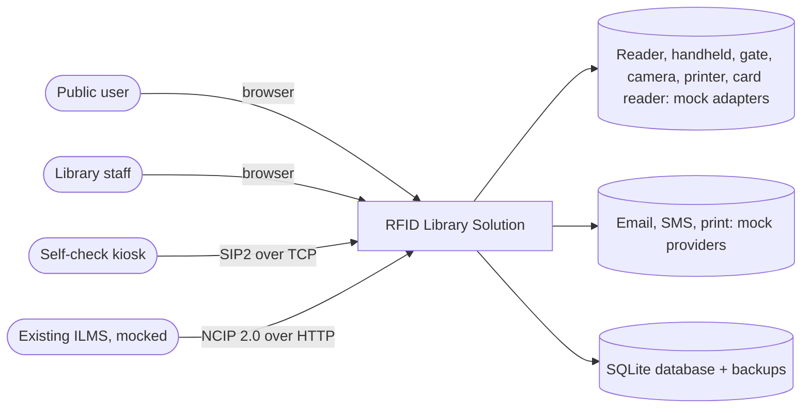
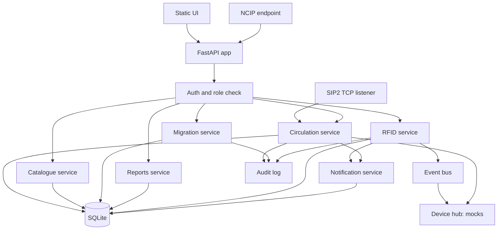
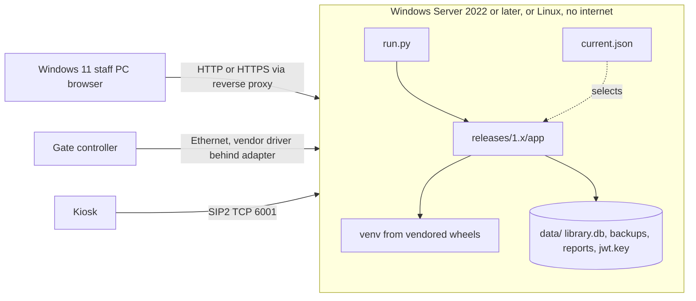

# D2 Architecture package

## 1. Context

## 2. Layers (SOP section 6)

| Layer | Where | Responsibility |
|---|---|---|
| User | `app/static/` | Staff console, OPAC, dashboard, reports, administration screens |
| Application | `app/main.py`, `app/services/` | Cataloguing, circulation, members, fines, inventory, notifications, reports, access control |
| RFID middleware | `app/rfid/` | Device-neutral protocols and events for reader, handheld, gate, card reader, printer, camera. Event bus with idempotency, retries, spool and replay |
| Interoperability | `app/adapters/` | NCIP 2.0 adapter and SIP2 adapter. Both call the same circulation service, so the rules are identical |
| Data | `app/models.py`, `app/ops/schema.py`, `app/ops/backup.py` | Transactional database, FTS5 search index, audit log, staging tables, backup and restore |
| Integration | `app/services/notifications.py`, `app/rfid/devices.py` | Email, SMS, print, CCTV photo connectors as provider-neutral adapters with mocks |
| Operations | `app/config.py`, `app/cli.py`, `app/ops/updater.py`, `packaging/` | Configuration, secrets, offline installer, health checks, updates, backups, rollback |

## 3. Components

## 4. Deployment (offline site)

Release layout: `releases/<version>/` holds the code, `current.json` points at the active version, `data/` is shared by all releases. An update installs a new release folder, migrates the database and only then flips the pointer. Rollback keeps the old pointer and restores the pre-update backup.

## 5. Database

Single SQLite file in WAL mode. Foreign keys on. Search uses an FTS5 table `bib_fts` kept current by insert, update and delete triggers (real-time indexing). Integrity rules enforced by the database itself:

- accession number and barcode are unique;
- partial unique index: one active tag per item, one active tag per uid;
- partial unique index: one open loan per item.

Schema changes are numbered migrations in `app/ops/schema.py` recorded in `schema_version`. They only move forward. The safety net for a failed migration is the automatic pre-update backup, because SQLite can commit DDL early.

## 6. Interfaces

| Interface | Protocol | Notes |
|---|---|---|
| Web API | HTTP and JSON, bearer token | Generated reference at `/docs` and `/openapi.json` |
| Public OPAC | `GET /opac/search?q=` | Read-only, no member or loan data |
| NCIP 2.0 | `POST /integrations/ncip`, XML | CheckOutItem, CheckInItem, RenewItem, LookupItem, LookupUser. Needs the `integration` role. DTDs and entities rejected |
| SIP2 | TCP, CR terminated, default port 6001 | 93/94, 99/98, 23/24, 17/18, 11/12, 09/10, 29/30. Login required |
| Device protocols | Python `Protocol` classes in `app/rfid/devices.py` | Reader, handheld, gate, card reader, printer, camera. Mocks are scriptable for tests |
| Event bus | In process | Events carry an id. Same id is handled once. Failed handlers are retried then spooled and replayed in order |

## 7. Security design

| Control | How |
|---|---|
| Passwords | scrypt with a random salt per password |
| Sessions | HS256 tokens with an expiry. Secret generated per install and kept in `data/jwt.key` (mode 600) or supplied by environment |
| Authorisation | Role permission matrix checked on the server for every route. Roles: admin, librarian, assistant, integration |
| Smart card | Card UID maps to a user. Failed attempts are audited with the UID masked |
| Audit | Every login, failure, circulation action, tag, import, backup and admin action is recorded |
| Input | Pydantic models, parameterised SQL, search words stripped to letters and digits, upload type checks, safe XML parser |
| Supply chain | Pinned `requirements.lock`, SBOM with licences, SHA-256 manifest verified before any update is applied |
| Privacy | Synthetic data only. Card UIDs masked in logs |
| Transport | Put a TLS reverse proxy in front for production. Not terminated by the app |

## 8. Key decisions

| # | Decision | Alternatives | Reason |
|---|---|---|---|
| D1 | Python, FastAPI, SQLAlchemy 2 | .NET, Java | Fast to build and test, runs on Windows and Linux, small offline footprint |
| D2 | SQLite for the demo | PostgreSQL | No server to install in an isolated site demo. Same SQLAlchemy models can target PostgreSQL, but that path is not tested here |
| D3 | Custom numbered migrations | Alembic | One small runner that records versions and works offline. Alembic would be a sound choice in production |
| D4 | Mock devices behind Protocols | Vendor SDK stubs | SDKs are unavailable. Contract plus mock lets real drivers drop in |
| D5 | One circulation service for UI, NCIP and SIP2 | Separate logic per protocol | Rules cannot drift between channels |
| D6 | Gate decides locally | Ask the ILMS per read | Required to work while the ILMS is offline |
| D7 | Vendored wheels plus manifest | Docker image | Docker may not exist at the site. The same approach could ship an image later |
| D8 | Fail closed on device fault | Allow and log | A failed security-bit write must not let an item leave unprotected |
| D9 | Plain HTML, CSS, JS UI | React build | No build chain and no CDN needed offline |
